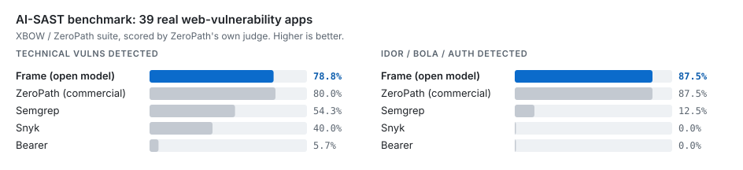
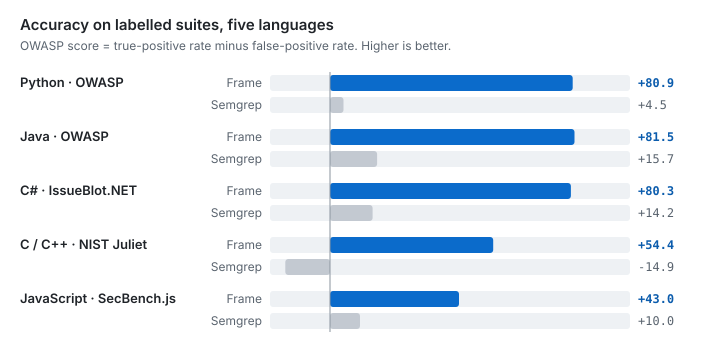
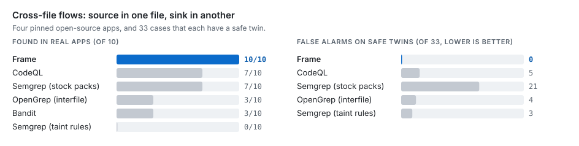

<p align="center">
  
  <p align="center">
    <strong>Sound static analysis and LLM reasoning, in one security agent</strong>
  </p>
  <p align="center">
    <a href="https://github.com/lambdasec/frame/actions/workflows/tests.yml"></a>
    <a href="#"></a>
    <a href="LICENSE"></a>
  </p>
</p>

---

Frame finds vulnerabilities by **following attacker data through your code**, across functions, files and layers, and proves each finding with a solver instead of pattern-matching. A sound symbolic core (taint analysis plus separation logic and Z3) does the finding; an optional LLM layer adds recall, then exploits and fixes what was found. The two tiers are reported separately and never confused.

- **Five languages**: Python, JavaScript/TypeScript, Java, C# and C/C++, lowered to one intermediate language.
- **Cross-file by default**: a request that enters a controller and reaches a query three files away is one finding.
- **70+ framework packs**: Flask to Spring to ASP.NET to Express, plus your own stack in one TOML file.
- **Built for guardrails**: scan only what changed, baseline what you accept, and verify that a fix really removed the bug.
- **Its own separation logic prover**: entailment, frame inference, bi-abduction and countermodels over Z3, with inductive predicates, strings, arithmetic, arrays and bitvectors. It decides C/C++ memory safety in the scanner and is usable on its own ([details](#the-separation-logic-engine)).
- **Runs on open models**: every LLM number below uses an open model, local or hosted.

## Results

<p align="center"></p>

<p align="center"></p>

<p align="center"></p>

| Benchmark | What it measures | Frame | Comparison |
|-----------|------------------|-------|------------|
| [XBOW / ZeroPath](benchmarks/xbow_zeropath/REPORT.md) | AI-SAST on 39 web-vuln apps | detect **78.8%**, FP **26.3%** | ZeroPath 80% / 25%, Semgrep 54% / 45% |
| [Endor Labs corpus](benchmarks/endor_corpus/README.md) | 193 vulns in 5 production apps | recall **0.67**, precision **0.51** | Semgrep 0.52 / 0.40 |
| [RealVuln IDOR/BOLA](benchmarks/realvuln_authz/REPORT.md) | Broken authorization, 4 real apps | **6/8** found, precision **1.00** | 0 false positives on safe controls |
| [CVE-Bench](benchmarks/cve_bench/README.md) | Detect, exploit, fix on 10 live CVEs | **5 / 4 / 4** of 10 | each stage verified on a live target |
| [SusVibes](benchmarks/susvibes/README.md) | 181 real-CVE Python pairs | recall **0.14**, precision **0.56** | Semgrep 0.06 / 0.55 |
| [Cross-file exemplars](benchmarks/exemplars/README.md) | Hand-labelled precision on 4 real apps | **98%** | CodeQL 95% |

## See it work

A three-file Flask app. The request enters in `app.py`; the query runs in `services/orders.py`:

```python
# shop/app.py
@app.route("/orders")
def list_orders():
    customer = request.args.get("customer", "")
    return jsonify(orders.for_customer(customer))

# shop/services/orders.py
def for_customer(name):
    cur.execute("SELECT * FROM orders WHERE customer = '" + name.strip() + "'")
```

```console
$ frame scan benchmarks/exemplars/quickstart --root benchmarks/exemplars/quickstart
1. [CRITICAL] 🔴 sql_injection
   Location: benchmarks/exemplars/quickstart/shop/services/orders.py:8:4
   Function: for_customer
   Description: Tainted data from 'customer' flows to sql sink
   CWE: CWE-89
   Data flow: shop/app.py:11 -> shop/services/orders.py::for_customer(name)
2. [CRITICAL] 🔴 command_injection
   ...
Scanned 4 files: 2 findings (2 critical)
```

Switch to a placeholder query, or wrap the value in `int()`, and the finding goes away. Frame knows what makes data safe (parameterised queries, `shlex.quote`, `basename`, allow-lists, `isdigit()` and anchored-regex checks, numeric conversion) per branch, so `if x in ALLOWED: pass` followed by the sink is still flagged.

## Install and run

```bash
git clone https://github.com/lambdasec/frame.git && cd frame
pip install -e ".[scan]"                # scanner + all language grammars

frame scan src/                         # every supported language under src/
frame scan src/ -l java                 # one language (or -p "app/**/*.py")
frame scan src/ -f sarif -o out.sarif --fail-on high    # CI: SARIF, non-zero exit on high+
frame scan src/ --ai                    # add LLM detection and triage
```

Text output lists the files with findings and a summary line; `-f json` and `-f sarif` add stable paths and fingerprints. Exit status: 0 clean, 1 findings at or above `--fail-on`, 2 the scan could not run.

## What Frame understands

### Data flow across files

| | Same file | Across files |
|---|---|---|
| **Python** | functions, methods, returns, callbacks | imports, re-exports, star imports, aliases, factories, injected objects |
| **JavaScript / TypeScript** | functions, closures, classes, callbacks | `require`/`import`, barrels, default exports, tsconfig `paths`, class instances |
| **Java** | helpers, overloads | packages, imports, single-implementation interfaces, supertypes |
| **C#** | calls by declared type, DI-style fields | namespaces, `using`, interfaces, base classes |
| **C / C++** | helper sinks, returned data, buffers filled by a helper | per file |

Resolution is deliberately narrow and never guessed. A helper that sanitises its argument clears the flow; one that only looks like validation (`return x.strip()`) does not.

### Frameworks, out of the box

| Language | Frameworks and libraries |
|---|---|
| **Python** | Flask, Django, DRF, FastAPI, Starlette, Tornado, aiohttp, Sanic, Bottle, Falcon, Pyramid, CherryPy, Jinja2/Mako, SQLAlchemy, peewee, pymongo, requests/httpx |
| **JavaScript / TypeScript** | Express, Koa, Fastify, Hapi, Restify, NestJS, Next.js, Sails, Apollo, Socket.IO, AWS Lambda, Electron, React, Angular, Mongoose, Prisma, Knex, TypeORM |
| **Java** | Spring MVC/Boot/WebFlux, JAX-RS (Jersey, RESTEasy, Quarkus), Struts 2, JSF, Servlet/JSP, Vert.x, Spark, Javalin, Micronaut, Play, Hibernate/JPA, MyBatis, jOOQ |
| **C#** | ASP.NET Core MVC and Web API, Minimal APIs, Razor Pages, Blazor, SignalR, Azure Functions, WebForms, WCF/gRPC, EF Core/EF6, Dapper, NHibernate |
| **C / C++** | CGI/FastCGI, POSIX sockets, libmicrohttpd, civetweb/Mongoose, cpp-httplib, Crow, Qt, Boost.Beast, gRPC, libcurl, OpenSSL, libxml2, libarchive, SQLite/libpq/MySQL |

Every pack is proven by a vulnerable app and its safe twin, scanned through the real CLI in the test suite: 80+ apps and 400+ labelled flaws in [`benchmarks/exemplars/frameworks/`](benchmarks/exemplars/frameworks).

<details>
<summary><b>Teach it your own framework</b> (one TOML file)</summary>

```toml
# .frame/packs/acme.toml  (picked up automatically; or --pack PATH, or packs = [...] in .frame.toml)
[pack]
name = "acme"
language = "python"
detect = { imports = ["acme"] }          # applies only to files that use it

[[entrypoint]]                           # who receives attacker data
decorator = ["acme.web.route"]
params = "all"

[[source]]
call = ["acme.web.param"]

[[sink]]
call = ["acme.store.query_sql"]
kind = "sql"

[[sink]]                                 # only when shell=True
call = ["acme.proc.launch"]
kind = "command"
when_kwarg = { name = "shell", value = "True" }

[[sanitizer]]
call = ["acme.text.sql_clean"]
kinds = ["sql"]
```

`frame packs check acme.toml` validates it, naming the file and field of any unknown key or kind. A pack refines the built-in knowledge of a call instead of replacing it.

</details>

### What it detects

80+ vulnerability classes. The symbolic core proves the ones reachable by taint or memory reasoning; the LLM layer adds authorization and business-logic flaws.

| Injection | Access control | Data exposure and crypto | Memory safety |
|---|---|---|---|
| SQL / NoSQL / ORM (CWE-89, 943) | IDOR / BOLA (CWE-639) | Path traversal (CWE-22) | Buffer overflow (CWE-121/122) |
| XSS (CWE-79) | Authorization bypass (CWE-285) | SSRF (CWE-918) | Use-after-free (CWE-416) |
| Command and code (CWE-78/94) | Mass assignment (CWE-915) | Open redirect (CWE-601) | Double / invalid free (CWE-415) |
| Template (SSTI) | Broken authentication | XXE (CWE-611) | Null dereference |
| LDAP / XPath / XML | Session fixation | Secrets, unsafe deserialization | Integer overflow |
| Header and log | CSRF (CWE-352) | Weak crypto, hashing, random | Format string |

Protection-off switches (Flask `debug=True`, insecure cookie flags, Django `DEBUG`) are reported separately as `hardening`.

## Guardrails for CI and coding agents

```bash
frame scan . --write-baseline .frame-baseline.json --fail-on none                 # accept today's state
frame scan . --changed origin/main --baseline .frame-baseline.json -f json -o new.json   # only what's new
frame verify new.json          # after a fix: fixed / present / suppressed / uncertain / unverifiable
```

`--changed` widens to the files that import what changed, since editing a helper can make an untouched caller vulnerable. Fingerprints contain no line numbers, so inserting code above a finding keeps its identity, and `verify` never mistakes silencing or moving a finding for fixing it.

```yaml
# GitHub Actions
- run: pip install -e ".[scan]"
- run: frame scan src/ -f sarif -o results.sarif --fail-on high
- uses: github/codeql-action/upload-sarif@v3
  with:
    sarif_file: results.sarif
```

SARIF carries CWE tags and `security-severity`, so GitHub code scanning ranks the alerts.

<details>
<summary><b>Suppressions and configuration</b></summary>

Silence a reviewed finding inline, optionally by rule:

```python
cursor.execute(query)  # frame: ignore[CWE-89] query is a static string
```

A marker covers its own line or the comment-only line above it. Suppressed findings are counted and kept in the JSON; `--no-suppress` reports everything.

Project defaults live in `.frame.toml` (or `[tool.frame]` in `pyproject.toml`):

```toml
min_severity = "medium"
fail_on = "high"
disable = ["CWE-798", "weak_hash"]   # CWE ids or finding types
exclude = ["vendor", "third_party"]  # added to the default excludes
packs = ["security/acme.toml"]
```

Command-line flags win over the file. Directory scans skip `.git`, `node_modules`, `.venv`, `__pycache__` and similar; `--no-default-excludes` scans them.

</details>

## The AI layer: detect, triage, exploit, fix

Structural analysis cannot reach everything: unknown frameworks, context-dependent flows, business logic. `--ai` adds an LLM layer, and the symbolic core grounds it at every stage.

<p align="center">
  
</p>

- **Detect**: the model explores the repo with file and search tools. A finding grounded in a sink Frame recognises is promoted to `llm_verified`. This also covers languages with no symbolic frontend (PHP, Ruby, Go).
- **Triage**: drops confident false positives, keeping a finding unless it finds the mitigating control.
- **Exploit**: an agent builds and runs a proof of concept against a live, authorized target, and stops only on observable success.
- **Fix**: generates a patch, re-scans, and confirms the bug is gone with no regressions.

```bash
export FRAME_LLM_BASE_URL=http://localhost:47317/v1     # any OpenAI-compatible endpoint
export FRAME_LLM_MODEL=mlx-community/Qwen3.6-35B-A3B-OptiQ-4bit
export FRAME_LLM_REPO_ROOT=/path/to/repo

frame scan src/ --ai
frame scan ./repo --ai -f json | frame exploit --target http://app:8080 --guidance - --goal 'read /etc/secret'
frame fix app.py --guidance findings.json --diff
```

<details>
<summary><b>Serving a local model on Apple Silicon</b></summary>

```bash
pip install mlx-optiq
optiq kv-cache mlx-community/Qwen3.6-35B-A3B-OptiQ-4bit --target-bits 5.0 -o ./kv
optiq serve --model mlx-community/Qwen3.6-35B-A3B-OptiQ-4bit \
  --kv-config ./kv/kv_config.json --port 47317 --mtp    # --mtp: ~1.4x faster decode
```

Hosted open models (our benchmarks also use GLM-5.2) work through the same variables.

</details>

## Commands

| Command | What it does |
|---------|--------------|
| `frame scan <path>` | Scan for vulnerabilities. `-f text\|json\|sarif`, `-o`, `-l`, `-p`, `--fail-on`, `--min-severity`, `--ai`, `--pack`, `--no-cross-file`, `--root` |
| `frame scan --changed [REF]` / `--files` | Scan only what changed, plus the files that import it |
| `frame scan --baseline F` / `--write-baseline F` | Report only findings not in the baseline; write or update one |
| `frame verify <findings.json>` | Re-scan the files behind earlier findings and report each one's status |
| `frame packs list \| check` | List the packs a scan would load; validate pack files |
| `frame exploit --target <url>` | Exploit a live, authorized target, primed with `--guidance` |
| `frame fix <path>` | Fix each finding, then re-scan to confirm (`--in-place` or `--diff`) |
| `frame solve "<P> \|- <Q>"` | Prove or refute an entailment; `--model` prints a countermodel, `--unfold-depth`, `--timeout`, `--format json` |
| `frame check <file>` | Check a batch of entailments, one per line (`--stop-on-failure`, `--format json\|csv`) |
| `frame parse "<formula>"` / `frame repl` | Show a formula's structure (`--format tree\|json\|sexp`); interactive prover |

Run `frame <command> --help` for every flag.

## How it works

A per-language frontend lowers source into SIL, a separation intermediate language. Taint tracking follows untrusted data from sources to sinks through calls, returns and branches; symbolic execution explores paths with per-edge path conditions, and Z3 discharges the reachability proof, so a bug is reported only when its path is feasible. Framework packs and built-in specs feed the same analysis: a new framework is data, not code.

C and C++ memory safety (use-after-free, double free, leaks, null dereference, uninitialised reads, out-of-bounds indexing) is decided structurally, by tracking ownership and heap state in separation logic and asking the solver whether the bad state is reachable.

## The separation logic engine

Underneath the scanner is a complete separation logic prover built on Z3, usable on its own from the CLI or Python. Heaps are encoded as Z3 arrays with explicit allocation domains (the heap-as-array approach of Piskac, Wies and Zufferey), and inductive predicates are reasoned about with lemmas, goal-directed folding and adaptive unfolding before anything reaches the SMT solver.

<p align="center"></p>

| Capability | What you get |
|---|---|
| **Entailment** `P \|- Q` | Valid or invalid, with a Z3 countermodel for invalid ones (`--model`) |
| **Satisfiability and equivalence** | `is_satisfiable(P)`, `check_equiv(P, Q)`; contradictions such as `x \|-> 1 * x \|-> 2` are detected |
| **Frame inference and bi-abduction** | `find_frame(P, Q)` returns the leftover heap R with `P \|- Q * R`; `abduce_frame` returns the missing heap |
| **Inductive predicates** | list segments `ls`, null-terminated `list`, doubly linked `dll`, binary `tree`, sorted `sls`, nested `nll`, skip lists `skl1`-`skl3`, `lsso`, reversed `RList` |
| **Custom predicates** | Define your own (in Python or from SMT-LIB definitions); each is validated for strict positivity, bound variables and arity before use |
| **Proof techniques** | Lemma library (list, DLL, compositional and wand lemmas), goal-directed folding of points-to chains into predicates, cyclic unfolding, heap-graph pattern analysis, syntactic fast paths |
| **Theories** | Linear integer arithmetic, strings (concatenation, length, substring, `contains`, regex `matches`), arrays and bitvectors, all combined with the heap |
| **Security vocabulary** | `Source`, `Sink`, `Taint`, `Sanitized` and error states (`NullDeref`, `UseAfterFree`, `BufferOverflow`) as first-class formulas |
| **Magic wand** | `P -* Q` in the AST and SMT encoding, with wand lemmas |
| **Robust by design** | Bounded, adaptive unfolding; deep recursion and solver timeouts return `unknown` instead of crashing |

```console
$ frame solve "x |-> y * y |-> nil |- ls(x, nil)"
✓ VALID
$ frame solve 'x = "ab" ++ "c" |- x = "abc"'
✓ VALID
$ frame solve "x |-> 5 |- x |-> 6" --model
✗ INVALID
  Countermodel: [x = 2, hval = [else -> 5], ...]
$ frame check entailments.txt --format json          # batch mode, one entailment per line
$ frame repl                                          # interactive prover
```

```python
from frame import EntailmentChecker, parse

checker = EntailmentChecker()
checker.check_entailment("ls(x, y) * ls(y, nil) |- ls(x, nil)").valid        # True
checker.find_frame(parse("x |-> 5 * y |-> 3"), parse("x |-> 5"))            # y |-> 3
checker.is_satisfiable(parse("x |-> 1 * x |-> 2"))                          # False
```

| Syntax | Meaning |
|--------|---------|
| `emp`, `x \|-> v` | empty heap; x points to v (`x \|-> (a, b)` for records) |
| `P * Q` | P and Q hold in disjoint parts of the heap |
| `P & Q`, `P \| Q`, `!P` | conjunction, disjunction, negation |
| `x = y`, `x != y`, `x < y + 1` | equality and arithmetic |
| `exists x. P`, `forall x. P` | quantifiers |
| `P \|- Q` | P entails Q |

Every SL-COMP division runs from one harness (`python -m benchmarks run --division qf_shls_entl`), which reads the competition's SMT-LIB 2 files directly. [benchmarks/README.md](benchmarks/README.md) has every division, corpus and method.

<details>
<summary><b>Scanner Python API</b></summary>

```python
from frame.sil import FrameScanner

result = FrameScanner(language="python").scan_file("app.py")
for vuln in result.vulnerabilities:
    print(f"{vuln.cwe_id}: {vuln.description}")

results = FrameScanner(packs=["security/acme.toml"]).scan_directory("src/", pattern=None)
```

</details>

## Contributing

```bash
pip install -e ".[dev]"
python -m pytest tests/ -n auto        # 3,400+ tests; tests/e2e scans realistic projects through the real CLI
ruff check frame tests benchmarks
```

`CLAUDE.md` is the engineering map of the scanner. To add a framework, write a pack under `frame/sil/packs/data/<language>/` and a vulnerable/safe app pair under `benchmarks/exemplars/frameworks/`; the fixture test checks both.
