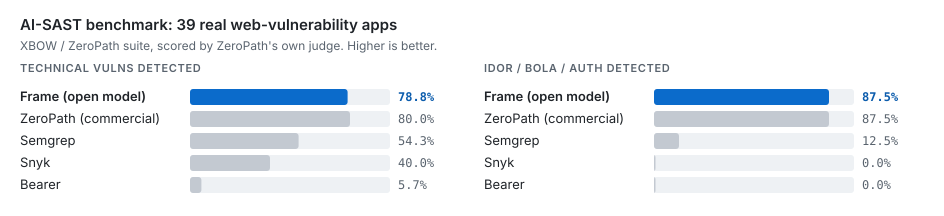
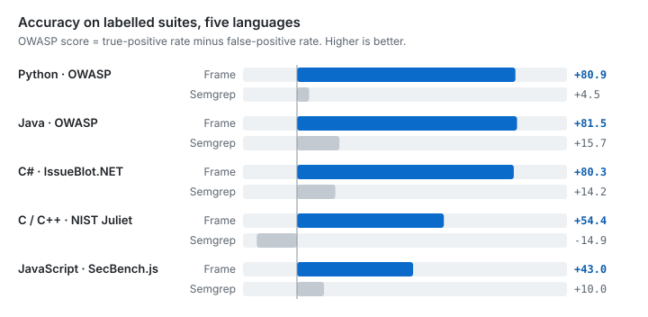
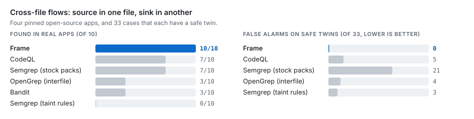
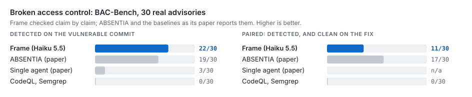

<p align="center">
  
  <p align="center">
    <strong>The sound, open SAST for modern apps: code, dependencies, secrets, infrastructure and AI, in one tool</strong>
  </p>
  <p align="center">
    <a href="https://github.com/lambdasec/frame/actions/workflows/tests.yml"></a>
    <a href="https://pypi.org/project/frame-security/"></a>
    <a href="https://pepy.tech/projects/frame-security"></a>
    <a href="https://github.com/marketplace/actions/frame-security-scan"></a>
    <a href="https://github.com/lambdasec/frame/blob/main/LICENSE"></a>
  </p>
</p>

Frame finds vulnerabilities by **following attacker data through your code**, across functions, files and layers, and **proves each finding with a solver** instead of pattern-matching. One open tool covers what a modern app needs scanned: the code, its dependencies, its secrets, its infrastructure and its AI calls. It runs offline, and the same soundness that keeps false alarms down lets it prove a fix actually removed the bug.

<p align="center"></p>

Where a team runs Semgrep for code, Snyk or Endor Labs for dependencies, gitleaks for secrets and checkov for infrastructure, Frame is one tool that does all of it, proves what it reports, and stays free and local. It is a genuine alternative to Semgrep, Snyk, Endor Labs, Veracode and ZeroPath: open where they are closed, sound where they pattern-match, and complete where they cover one layer. The numbers are in [Benchmarks](#benchmarks).

## What Frame scans

- **Code, across files, in five languages**: Python, JavaScript/TypeScript, Java, C# and C/C++. A request that enters a controller and reaches a query three files away is one finding, not a lead. 100+ finding types, from SQL injection and SSRF to IDOR and C/C++ memory safety, each proved by taint or by the separation logic engine. [110 framework packs](https://github.com/lambdasec/frame/blob/main/docs/coverage.md) (Flask, Django, Spring, ASP.NET, Express, and more), plus your own stack in one TOML file.
- **[Broken access control](https://github.com/lambdasec/frame/blob/main/docs/ai.md#hunting-authorization-flaws---hunt-authz), with an agent the engine directs**: IDOR, missing authorization, privilege escalation and mass assignment turn on intent, so `--hunt-authz` sends a model through the app unit by unit, with the engine planning the work and answering its questions. Every handler gets a verdict, and what the code cannot decide is reported as unresolved rather than called safe. 22 of 30 real advisories on BAC-Bench, ahead of ABSENTIA's 19; CodeQL and Semgrep find none.
- **Dependencies, by reachability**: lockfiles of 11 ecosystems plus C/C++ and vendored copies, matched against OSV offline, ranked by whether attacker data actually reaches the vulnerable function, with upgrades Frame plans, applies and verifies against your tests, plus licence policy, SBOM and VEX.
- **[Secrets](https://github.com/lambdasec/frame/blob/main/docs/secrets.md), including git history**: credential-named values and 15 providers' key formats (AWS, GitHub, Stripe, OpenAI, and more), in code and in every commit the history ever added, with optional live verification against the provider's own API so a real leak is told from a test fixture.
- **Infrastructure as code**: Kubernetes against the Pod Security Standards (matching the admission controller's own evaluator), Dockerfiles as BuildKit parses them, Terraform as HCL evaluates it (AWS, Azure, Google Cloud), and CloudFormation with its intrinsic functions. Every policy is decided with Z3, and what depends on values the files do not give is reported as undecided, not guessed.
- **Containers**: OS packages read from an image's layers (Debian, Ubuntu, Alpine, RHEL and more) and matched against the distributions' own advisories.
- **[AI applications](https://github.com/lambdasec/frame/blob/main/docs/llm-security.md)**: prompt injection, model output reaching a sink, and MCP servers, including hidden instructions in tool metadata that the person approving the tool cannot see, mapped to the OWASP LLM Top 10.

## Why it is different

- **Sound, not pattern-based**: findings are proved by a solver (its own [separation logic engine](https://github.com/lambdasec/frame/blob/main/docs/engine.md) on Z3: entailment, frame inference, bi-abduction, countermodels), so there are fewer false alarms and a fix can be proved to remove the bug.
- **Open rules and advisories, as data**: framework packs and the full advisory database ship as versioned public datasets, [`lambdasec/frame-kb`](https://huggingface.co/datasets/lambdasec/frame-kb) and [`lambdasec/frame-advisories`](https://huggingface.co/datasets/lambdasec/frame-advisories) (rebuilt daily), updated between releases and pinnable for air-gapped CI. Nothing in them runs.
- **Built for the AI-coding era**: scan only what changed, baseline what you accept, and `verify` that a fix removed the bug; a [GitHub Action](https://github.com/marketplace/actions/frame-security-scan), a pre-commit hook, and an [MCP server](https://github.com/lambdasec/frame-mcp) for Claude Code, Codex, Cursor and other coding agents.
- **Runs on open models, local or hosted**: an optional LLM layer adds recall for business-logic and authorization flaws, triages, and proposes fixes the sound core then verifies; it works with any OpenAI-compatible model, including on-device.
- **One config file**: every setting in `.frame.toml` (or `[tool.frame]` in `pyproject.toml`), checked strictly, with one precedence order: flag, then environment variable, then file. [Example configs](https://github.com/lambdasec/frame/blob/main/examples/configs/README.md).

## Quick start

```bash
pip install "frame-security[scan]"
frame scan src/
```

A three-file Flask app, where the request enters in `app.py` and the query runs in `services/orders.py`:

```python
# shop/app.py
@app.route("/orders")
def list_orders():
    customer = request.args.get("customer", "")
    return jsonify(orders.for_customer(customer))

# shop/services/orders.py
def for_customer(name):
    cur.execute("SELECT * FROM orders WHERE customer = '" + name.strip() + "'")
```

```console
$ frame scan benchmarks/exemplars/quickstart --root benchmarks/exemplars/quickstart
1. [CRITICAL] 🔴 sql_injection
   Location: benchmarks/exemplars/quickstart/shop/services/orders.py:8:4
   Description: Tainted data from 'customer' flows to sql sink
   CWE: CWE-89
   Data flow: shop/app.py:11 -> shop/services/orders.py::for_customer(name)
...
Scanned 4 files: 2 findings (2 critical)
```

Use a placeholder query, or wrap the value in `int()`, and the finding goes away.

For dependencies (advisories come from [`lambdasec/frame-advisories`](https://huggingface.co/datasets/lambdasec/frame-advisories), cached once, then offline):

```bash
frame kb pull --advisories            # cache the advisories once (then everything runs offline)
frame deps --vulns                    # vulnerable dependencies, and whether your code calls the vulnerable function
frame deps --vulns --apply --relock   # upgrade, re-lock, report what is left
frame scan . --sca                    # attacker data reaching a vulnerable function, at the call site
```

For secrets, infrastructure and a repo inventory:

```bash
frame scan . --verify-secrets         # credentials in code, checked live against the provider
frame history .                        # credentials anywhere in the git history
frame iac .                            # Kubernetes, Dockerfiles, Terraform, CloudFormation (or frame scan . --iac)
frame inventory .                      # languages, frameworks, dependencies, IaC, containers, AI SDKs, MCP tools
```

With a model (any OpenAI-compatible endpoint, local or hosted; [AI layer](https://github.com/lambdasec/frame/blob/main/docs/ai.md)):

```bash
export FRAME_LLM_BASE_URL=http://localhost:47317/v1  FRAME_LLM_MODEL=<model>   # or [llm] in .frame.toml
frame scan src/ --ai                  # LLM detection and triage on top of the engine
frame scan . --hunt-authz             # hunt for broken access control, a verdict on every handler
frame fix app.py --guidance findings.json --diff   # patch, re-scan, confirm
```

## Benchmarks

<p align="center"></p>

<p align="center"></p>

<p align="center"></p>

| Benchmark | What it measures | Frame | Comparison |
|-----------|------------------|-------|------------|
| [XBOW / ZeroPath](https://github.com/lambdasec/frame/blob/main/benchmarks/xbow_zeropath/REPORT.md) | AI-SAST on 39 web-vuln apps | detect **78.8%**, FP **26.3%** | ZeroPath 80% / 25%, Semgrep 54% / 45% |
| [Endor Labs corpus](https://github.com/lambdasec/frame/blob/main/benchmarks/endor_corpus/README.md) | 193 vulns in 5 production apps | recall **0.67**, precision **0.51** | Semgrep 0.52 / 0.40 |
| [BAC-Bench](https://github.com/lambdasec/frame/blob/main/benchmarks/bacbench/REPORT.md) | Broken access control, 30 real advisories | **22/30** found, 11 paired | ABSENTIA 19 / 17, CodeQL and Semgrep 0 |
| [RealVuln IDOR/BOLA](https://github.com/lambdasec/frame/blob/main/benchmarks/realvuln_authz/REPORT.md) | Broken authorization, 4 real apps | **6/8** found, precision **1.00** | 0 false positives on safe controls |
| [CVE-Bench](https://github.com/lambdasec/frame/blob/main/benchmarks/cve_bench/README.md) | Detect, exploit, fix on 10 live CVEs | **5 / 4 / 4** of 10 | each stage verified on a live target |
| [SusVibes](https://github.com/lambdasec/frame/blob/main/benchmarks/susvibes/README.md) | 181 real-CVE Python pairs | recall **0.14**, precision **0.56** | Semgrep 0.06 / 0.55 |
| [Cross-file exemplars](https://github.com/lambdasec/frame/blob/main/benchmarks/exemplars/README.md) | Hand-labelled precision on 4 real apps | **98%** | CodeQL 95% |

Methods and every suite, including SL-COMP for the engine, are in [benchmarks/README.md](https://github.com/lambdasec/frame/blob/main/benchmarks/README.md).

## Documentation

| | |
|---|---|
| [Usage](https://github.com/lambdasec/frame/blob/main/docs/usage.md) | Scanning, baselines and `verify`, the GitHub Action, pre-commit hook, MCP server and agent skill, suppressions, configuration, the knowledge base, every command and flag, environment variables, Python API |
| [Dependencies](https://github.com/lambdasec/frame/blob/main/docs/dependencies.md) | Supported ecosystems, advisories, reachability, upgrade plans, code mitigation, licences, SBOM, VEX, container images, CI |
| [Coverage](https://github.com/lambdasec/frame/blob/main/docs/coverage.md) | Cross-file resolution per language, supported frameworks, writing a pack, every vulnerability class |
| [Secrets](https://github.com/lambdasec/frame/blob/main/docs/secrets.md) | Hardcoded credentials by name and by provider format, git-history scanning, live verification with each provider and exactly what it sends |
| [AI app security](https://github.com/lambdasec/frame/blob/main/docs/llm-security.md) | Prompt injection, model output as taint, MCP tools and tool-metadata attacks, the OWASP LLM Top 10 |
| [Infrastructure as code](https://github.com/lambdasec/frame/blob/main/docs/iac.md) | Kubernetes, Dockerfiles, Terraform and CloudFormation, how close they are to Kubernetes, BuildKit and HCL, writing policies, how Z3 decides them |
| [AI layer](https://github.com/lambdasec/frame/blob/main/docs/ai.md) | Detect, triage, the authorization hunt, exploit and fix with any OpenAI-compatible model, including on-device |
| [Separation logic engine](https://github.com/lambdasec/frame/blob/main/docs/engine.md) | The prover under the scanner: capabilities, syntax, CLI, Python API, SL-COMP results |
| [Roadmap](https://github.com/lambdasec/frame/blob/main/docs/roadmap.md) | What is built, and what is next: data growth and proof-carrying findings (a test that triggers each finding in your own code) |
| [Examples](https://github.com/lambdasec/frame/blob/main/examples/README.md) | Runnable walkthroughs with real output: dependencies end to end, mitigations, adapting to a breaking upgrade, secrets, Kubernetes, AI apps and MCP servers, configuration files |
| [Exemplars](https://github.com/lambdasec/frame/blob/main/benchmarks/exemplars/README.md) | The quickstart app, a vulnerable and safe app per framework, and the cross-file comparison |
| Open datasets | Framework packs and spec tables, [`lambdasec/frame-kb`](https://huggingface.co/datasets/lambdasec/frame-kb); the OSV advisory database rebuilt daily, [`lambdasec/frame-advisories`](https://huggingface.co/datasets/lambdasec/frame-advisories) |

## Contributing

```bash
pip install -e ".[dev]"
python -m pytest tests/ -n auto
ruff check frame tests benchmarks
```

`CLAUDE.md` is the engineering map of the codebase. To add a framework, write a pack under `frame/sil/packs/data/<language>/` and a vulnerable/safe app pair under `benchmarks/exemplars/frameworks/`; the fixture test checks both.

## License

[Apache 2.0](https://github.com/lambdasec/frame/blob/main/LICENSE)
