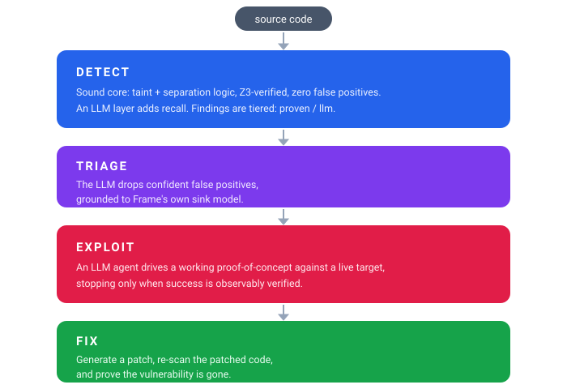

<p align="center">
  
  <p align="center">
    <strong>Sound static analysis and LLM reasoning, in one security agent</strong>
  </p>
  <p align="center">
    <a href="https://github.com/lambdasec/frame/actions/workflows/tests.yml"></a>
    <a href="#"></a>
    <a href="LICENSE"></a>
  </p>
</p>

---

Frame finds vulnerabilities by **following attacker data through your code**, across functions, files and layers, and proves each finding with a solver instead of guessing. A sound static core (taint analysis plus separation-logic verification with Z3) does the finding; an optional LLM layer adds recall, then exploits and fixes what was found. Symbolic findings are proven, LLM findings are tiered separately, and the two are never confused.

- **Five languages**: Python, JavaScript/TypeScript, Java, C# and C/C++, each lowered to one intermediate language.
- **Cross-file**: a request that enters a controller and reaches a query three files away is one finding, reported where the query is.
- **Framework-aware**: 70+ built-in packs (Flask to Spring to ASP.NET to Express) say where requests enter and which calls are dangerous. Add your own in a TOML file.
- **Built for guardrails**: scan only what changed, accept today's findings as a baseline, and check that a fix really removed the bug. This is the loop CI and coding agents need.

## See it work

A three-file Flask app. The request enters in `app.py`; the queries are in `services/orders.py`:

```python
# shop/app.py
@app.route("/orders")
def list_orders():
    customer = request.args.get("customer", "")
    return jsonify(orders.for_customer(customer))

# shop/services/orders.py
def for_customer(name):
    cur.execute("SELECT * FROM orders WHERE customer = '" + name.strip() + "'")
```

```console
$ frame scan benchmarks/exemplars/quickstart --root benchmarks/exemplars/quickstart
...
1. [CRITICAL] 🔴 sql_injection
   Location: benchmarks/exemplars/quickstart/shop/services/orders.py:8:4
   Function: for_customer
   Description: Tainted data from 'customer' flows to sql sink
   CWE: CWE-89
   Data flow: shop/app.py:11 -> shop/services/orders.py::for_customer(name)
2. [CRITICAL] 🔴 command_injection
   Location: benchmarks/exemplars/quickstart/shop/services/orders.py:13:4
   ...
Scanned 4 files: 2 findings (2 critical)
```

The finding is reported in the file that holds the sink, and `Data flow` names the call site that supplied the data. Fix the query with a placeholder, or wrap the value in `int()`, and the finding goes away: Frame understands what makes data safe (parameterised queries, `shlex.quote`, `basename`, allow-lists, `isdigit()` and anchored-regex checks, numeric conversion), per branch, so `if x in ALLOWED: pass` followed by a sink is still flagged.

## Install

```bash
git clone https://github.com/lambdasec/frame.git
cd frame
pip install -e ".[scan]"      # scanner + all language grammars
# pip install -e ".[dev]"    # contributors: tests, ruff, mypy, benchmarks
```

## Quick start

```bash
frame scan app.py                       # one file
frame scan src/                         # a project: every supported language, each in its own
frame scan src/ -l java                 # only one language (or -p "app/**/*.py" for a glob)
frame scan src/ -f sarif -o out.sarif --fail-on high      # CI: SARIF, non-zero exit on high+
frame scan src/ --ai                    # add LLM detection and triage (see below)
frame packs list                        # the framework packs a scan would load
```

Directory output lists only the files with findings and ends with a summary line; `-f json` and `-f sarif` carry the same findings plus stable paths and fingerprints. Exit status: 0 clean, 1 findings at or above `--fail-on`, 2 the scan could not run.

## What Frame understands

### Data flow across functions, files and layers

Directory scans follow taint across imports and calls by default. What is resolved is deliberately narrow and never guessed:

| | Same file | Across files |
|---|---|---|
| **Python** | functions, methods (`self.m`, `R().m`, `r = R(); r.m`), returns, callbacks | imports, re-exports, star imports, aliases, factories, constructor-injected objects |
| **JavaScript / TypeScript** | functions, closures, classes, callback parameters | `require`/`import`, barrels, default exports, tsconfig `paths`, class instances |
| **Java** | helpers (String parameters are treated as untrusted) | packages, imports, interfaces with one implementation, supertypes, overloads |
| **C#** | calls by declared type, DI-style fields | namespaces, `using`, interfaces, base classes |
| **C / C++** | helper sinks, returned data, buffers filled by a helper | scanned per file |

A helper that sanitises its argument clears the flow; a helper that only *looks* like validation (`return x.strip()`) does not. `frame scan --changed` widens to the files that import what you changed, because editing a helper can make an untouched caller vulnerable.

### Frameworks, out of the box

Each pack tells Frame where attacker data enters (route handlers, bound parameters, request objects) and which framework calls are dangerous or safe. Every pack is proven by a realistic vulnerable app and its safe twin, scanned through the real CLI in the test suite.

| Language | Frameworks and libraries |
|---|---|
| **Python** | Flask, Django, DRF, FastAPI, Starlette, Tornado, aiohttp, Sanic, Bottle, Falcon, Pyramid, CherryPy, Jinja2/Mako, SQLAlchemy, peewee, pymongo, requests/httpx |
| **JavaScript / TypeScript** | Express, Koa, Fastify, Hapi, Restify, NestJS, Next.js, Sails, Apollo, Socket.IO, AWS Lambda, Electron, React, Angular, Mongoose, Prisma, Knex, TypeORM |
| **Java** | Spring MVC/Boot/WebFlux, JAX-RS (Jersey, RESTEasy, Quarkus), Struts 2, JSF, Servlet/JSP, Vert.x, Spark, Javalin, Micronaut, Play, Hibernate/JPA, MyBatis, jOOQ |
| **C#** | ASP.NET Core MVC and Web API, Minimal APIs, Razor Pages, Blazor, SignalR, Azure Functions, WebForms, WCF/gRPC, EF Core/EF6, Dapper, NHibernate |
| **C / C++** | CGI/FastCGI, POSIX sockets, libmicrohttpd, civetweb/Mongoose, cpp-httplib, Crow, Qt, Boost.Beast, gRPC, libcurl, OpenSSL, libxml2, libarchive, SQLite/libpq/MySQL |

The apps behind this table are in [`benchmarks/exemplars/frameworks/`](benchmarks/exemplars/frameworks): 80+ small applications with 400+ labelled flaws, each with a safe twin that must stay silent.

### Teach it your framework

An in-house web stack needs one TOML file, not a fork:

```toml
# .frame/packs/acme.toml  (picked up automatically; or --pack PATH, or packs = [...] in .frame.toml)
[pack]
name = "acme"
language = "python"
detect = { imports = ["acme"] }          # applies only to files that use it

[[entrypoint]]                           # who receives attacker data
decorator = ["acme.web.route"]
params = "all"

[[source]]
call = ["acme.web.param"]

[[sink]]
call = ["acme.store.query_sql"]
kind = "sql"

[[sink]]                                 # only when shell=True
call = ["acme.proc.launch"]
kind = "command"
when_kwarg = { name = "shell", value = "True" }

[[sanitizer]]
call = ["acme.text.sql_clean"]
kinds = ["sql"]
```

`frame packs check acme.toml` validates it (unknown keys and kinds are errors that name the file and field). A pack refines the built-in knowledge of the same call instead of replacing it.

### The guardrail loop

Built for CI gates and for coding agents that edit code and need to know what they broke:

```bash
frame scan . --write-baseline .frame-baseline.json --fail-on none      # accept today's state
frame scan . --changed --baseline .frame-baseline.json -f json -o findings.json   # only what's new
frame verify findings.json      # after the fix: fixed / present / suppressed / uncertain / unverifiable
```

Every finding has a stable fingerprint with no line number in it, so inserting code above a finding does not change its identity. `verify` never mistakes silencing (`# frame: ignore`) or moving a finding for fixing it.

### Hardening, resilience, reporting

- Explicit protection-off switches (Flask `debug=True`, insecure cookie flags, Django `DEBUG`) are reported separately as `hardening`.
- SARIF carries CWE tags and a `security-severity`, so GitHub code scanning ranks the alerts.
- Empty, binary, non-UTF-8 and minified files never abort a scan (undecodable bytes are replaced, minified files are skipped with a warning); a file that does not parse is analysed best-effort without a warning.

## What Frame detects

80+ vulnerability classes. The symbolic core proves the ones reachable by taint or memory reasoning; the LLM layer adds context-dependent, authorization and business-logic flaws.

<table>
<tr>
<td width="50%">

**Injection**
- SQL / NoSQL / ORM Injection (CWE-89, 943)
- Cross-Site Scripting (CWE-79)
- Command & Code Injection (CWE-78/94)
- Template Injection (SSTI)
- LDAP / XPath / XML Injection
- Header & Log Injection

</td>
<td width="50%">

**Access Control & Auth**
- IDOR / BOLA (CWE-639)
- Authorization Bypass (CWE-285)
- Mass Assignment (CWE-915)
- Broken Authentication
- Session Fixation
- CSRF (CWE-352)

</td>
</tr>
<tr>
<td>

**Data Exposure & Crypto**
- Path Traversal (CWE-22)
- SSRF (CWE-918)
- Open Redirect (CWE-601)
- XXE (CWE-611)
- Hardcoded Secrets, Insecure Deserialization
- Weak Crypto / Hashing / Random

</td>
<td>

**Memory Safety**
- Buffer Overflow / Underflow (CWE-121/122)
- Use-After-Free (CWE-416)
- Double / Invalid Free (CWE-415)
- Null Pointer Dereference
- Integer Overflow, Format String

</td>
</tr>
</table>

## Examples and benchmarks

[`benchmarks/exemplars/`](benchmarks/exemplars/README.md) is the living showcase, kept in step with the code:

- **[`quickstart/`](benchmarks/exemplars/quickstart)**: the three-file app above. Run it first.
- **[`frameworks/`](benchmarks/exemplars/frameworks)**: a vulnerable app and a safe twin per framework, with every flaw labelled in the source (`frame-expect: CWE-89`).
- **[Cross-file comparison](benchmarks/exemplars/README.md)**: Frame against Semgrep, OpenGrep, Bandit and CodeQL on controlled cases with safe twins, a blind hold-out and four pinned open-source apps, including where Frame loses.

**Real-world security benchmarks.** Frame is competitive with commercial AI-SAST vendors, validated on five independent datasets with published ground truth, spanning detection, exploitation and remediation on real applications. Every Frame number uses open models (local Qwen via mlx-optiq, or hosted GLM-5.2):

| Benchmark | What it measures | Frame | Comparison |
|-----------|------------------|------|-----------|
| [XBOW / ZeroPath](benchmarks/xbow_zeropath/REPORT.md) | AI-SAST on 39 web-vuln apps | detect **78.8%**, FP **26.3%** (technical) | ties ZeroPath (80% / 25%); beats Semgrep, Snyk, Bearer |
| [CVE-Bench](benchmarks/cve_bench/README.md) | Full loop, 10 live web CVEs | detect **5/10**, exploit **4/10**, fix **4/10** | each stage verified on a live target |
| [Endor Labs corpus](benchmarks/endor_corpus/README.md) | 193 vulns, 5 production apps | recall **0.67**, precision **0.51** | Semgrep recall 0.52, precision 0.40 |
| [RealVuln IDOR/BOLA](benchmarks/realvuln_authz/REPORT.md) | Broken authorization, 4 real apps | **6/8** detected, precision **1.00** | 0 false positives on safe controls |
| [SusVibes](benchmarks/susvibes/README.md) | 181 real-CVE Python pairs | recall **0.14**, precision **0.56** | Semgrep recall 0.06, precision 0.55 |

<sub>Each cell names its own metric. SusVibes is hard for every tool (independent, execution-verified ground truth). See each benchmark's report for methods and caveats.</sub>

**OWASP score, synthetic suites** (True Positive Rate minus False Positive Rate):

| Benchmark | Frame | Semgrep | Difference |
|-----------|:---:|:---:|:---:|
| **Python** (OWASP) | 80.9% | 4.5% | +76.4 pts |
| **Java** (OWASP) | 81.5% | 15.7% | +65.8 pts |
| **JavaScript** (SecBench.js) | 43.0% | 10.0% | +33 pts |
| **C/C++** (NIST Juliet) | 54.4% | -14.9% | +69.3 pts |
| **C#** (IssueBlot.NET) | 80.3% | 14.2% | +66.1 pts |

<sub>Higher is better. See [benchmarks/](benchmarks/) for detailed methods and results.</sub>

## Suppressions & configuration

Triage once, stay triaged. Silence a reviewed finding inline, with an optional rule list:

```python
cursor.execute(query)  # frame: ignore[CWE-89] query is a static string
```

A marker applies to its own line or the comment-only line directly above. `frame: ignore` alone silences every finding there; `frame: ignore[CWE-89, 79]` only those CWEs (or finding types such as `sql_injection`). Suppressed findings are counted (`summary.suppressed`) and kept in the JSON, never silently lost; `--no-suppress` reports everything.

Project defaults live in `.frame.toml` (or `[tool.frame]` in `pyproject.toml`), found by walking up from the scan target:

```toml
min_severity = "medium"
fail_on = "high"
disable = ["CWE-798", "weak_hash"]   # CWE ids or finding types
exclude = ["vendor", "third_party"]  # extra directories, added to the defaults
packs = ["security/acme.toml"]       # extra framework packs
```

Command-line flags win over the file (`--min-severity`, `--fail-on`, `--disable RULE`, `--pack PATH`, `--config PATH`, `--no-config`). Directory scans skip dependency and tool directories (`.git`, `node_modules`, `.venv`, `__pycache__`, ...); `--no-default-excludes` scans them anyway.

## AI-assisted detection, exploitation and fixing

The symbolic core is sound and precise, but structural analysis cannot reach everything: unknown frameworks, context-dependent flows, business logic. `--ai` adds an LLM layer, and the sound core grounds it at every stage:

```
DETECT  ->  TRIAGE  ->  EXPLOIT  ->  FIX
```

- **Detect** (recall): the model explores your repo with `read_file`/`grep` tools and traces flows across files. Each LLM finding is checked against Frame's own sink model; one grounded in a recognised sink moves up to `llm_verified`. LLM findings never mix with symbolic ones, and the layer also covers languages with no symbolic frontend (PHP, Ruby, Go, ...).
- **Triage** (precision): drops confident false positives, keeping a finding unless it *finds* the mitigating control.
- **Exploit**: an agent develops and runs a working proof-of-concept against a live, authorized target, and stops only when success is observably verified (`--success-check '<cmd>'` for an external oracle).
- **Fix**: generates a patch, re-scans, and confirms the vulnerability is gone with no regressions.

```bash
export FRAME_LLM_BASE_URL=http://localhost:47317/v1     # any OpenAI-compatible endpoint
export FRAME_LLM_API_KEY=                                # empty for local servers
export FRAME_LLM_MODEL=mlx-community/Qwen3.6-35B-A3B-OptiQ-4bit
export FRAME_LLM_REPO_ROOT=/path/to/repo                 # enables agentic cross-file tools

frame scan src/ --ai                                     # symbolic + LLM detection + triage
frame scan ./repo --ai -f json | \
  frame exploit --target http://app:8080 --guidance - --goal 'read /etc/secret'
frame fix app.py --guidance findings.json --diff         # patch, re-scan, confirm
```

On the [Endor Labs corpus](benchmarks/endor_corpus/README.md) the full mode reaches 0.67 recall at 0.51 precision (Semgrep: 0.52 / 0.40); the LLM layer recovers ~65 vulnerabilities in Java, JS/TS and C# that both the symbolic engine and Semgrep miss. It runs fully on-device with [mlx-optiq](https://mlx-optiq.com) serving [`mlx-community/Qwen3.6-35B-A3B-OptiQ-4bit`](https://huggingface.co/mlx-community/Qwen3.6-35B-A3B-OptiQ-4bit) on Apple Silicon, or on a hosted open model (our benchmarks use both, and GLM-5.2).

<details>
<summary>Serving the local model</summary>

```bash
pip install mlx-optiq
optiq kv-cache mlx-community/Qwen3.6-35B-A3B-OptiQ-4bit --target-bits 5.0 -o ./kv
optiq serve --model mlx-community/Qwen3.6-35B-A3B-OptiQ-4bit \
  --kv-config ./kv/kv_config.json --port 47317 --mtp    # --mtp: ~1.4x faster decode
```

</details>

## CI/CD

```yaml
# GitHub Actions
- name: Install Frame
  run: pip install -e ".[scan]"
- name: Security scan
  run: frame scan src/ --format sarif -o results.sarif --fail-on high
- name: Upload results
  uses: github/codeql-action/upload-sarif@v2
  with:
    sarif_file: results.sarif
```

For pull requests, scan only what the change can affect and fail only on new findings: `frame scan . --changed origin/main --baseline .frame-baseline.json`.

## Commands

Run `frame <command> --help` for all flags.

| Command | What it does |
|---------|--------------|
| `frame scan <path>` | Scan source for vulnerabilities. `-f text\|json\|sarif`, `-o`, `-l`, `-p`, `--fail-on`, `--min-severity`, `--ai`, `--pack`, `--no-packs`, `--no-cross-file`, `--root`. |
| `frame scan --changed [REF]` / `--files <paths>` | Scan only what changed, widened to the files that import it and everything those import. Nothing changed is a clean scan. |
| `frame scan --baseline F` / `--write-baseline F` | Report only findings the baseline does not record; write or update a baseline. |
| `frame verify <findings.json>` | Re-scan the files behind earlier findings: `fixed`, `file_removed`, `present`, `suppressed`, `uncertain`, `unverifiable`. `--id <fingerprint>` for one finding. |
| `frame packs list \| check` | List the packs a scan would load; validate pack files. |
| `frame exploit --target <url>` | Drive an LLM agent to exploit a live, authorized target, primed with `--guidance <findings.json\|->`. |
| `frame fix <path>` | Generate a fix per finding, then re-scan to confirm. `--in-place` or `--diff`. |
| `frame solve "<P> \|- <Q>"`, `check`, `parse`, `repl` | The separation-logic solver. |

## Python API

```python
from frame import EntailmentChecker
from frame.sil import FrameScanner

scanner = FrameScanner(language="python")
result = scanner.scan_file("app.py")
for vuln in result.vulnerabilities:
    print(f"{vuln.cwe_id}: {vuln.description}")

# directory scan, cross-file, with an extra pack
results = FrameScanner(packs=["security/acme.toml"]).scan_directory("src/", pattern=None)

# separation-logic verification
print(EntailmentChecker().check_entailment("x |-> 5 * y |-> 3 |- x |-> 5").valid)   # True
```

## How it works

A per-language frontend lowers source into SIL, a separation intermediate language. Taint tracking follows untrusted data from sources to sinks through calls, returns and branches; symbolic execution explores paths; Z3 discharges the reachability proof. A bug is reported only when it is provably reachable. Framework packs and the built-in specs feed the same analysis, so a new framework is data, not code.

<p align="center">
  
</p>

### The symbolic core: separation logic + Z3

Frame models heaps in separation logic and discharges the proof obligations with Z3, so it can prove a vulnerability reachable or prove it cannot happen. The same engine is exposed directly for verifying heap properties:

| Syntax | Meaning |
|--------|---------|
| `x \|-> v` | x points to value v |
| `emp` | Empty heap |
| `P * Q` | P and Q in separate memory |
| `P -* Q` | Magic wand |
| `P \|- Q` | P entails Q |

Built-in predicates: `ls(x,y)`, `list(x)`, `tree(x)`, `dll(x,p,y,n)`.

```bash
frame solve "ls(x, y) * ls(y, z) |- ls(x, z)"     # list-segment transitivity
```

The core is validated on the standard logic suites: SL-COMP (separation logic) at 79.9% and SMT-LIB QF_S (string theory) at 99.3%. [benchmarks/README.md](benchmarks/README.md) has every division, the real-world corpora, per-tool comparisons and methods.

## Contributing

```bash
pip install -e ".[dev]"
python -m pytest tests/ -n auto        # ~3,000 tests; tests/e2e scans realistic projects through the real CLI
ruff check frame tests benchmarks
```

`CLAUDE.md` is the engineering map of the scanner (frontends, cross-file resolution, packs, guards). To add a framework, write a pack under `frame/sil/packs/data/<language>/` and a vulnerable/safe app pair under `benchmarks/exemplars/frameworks/`; the fixture test checks both.
