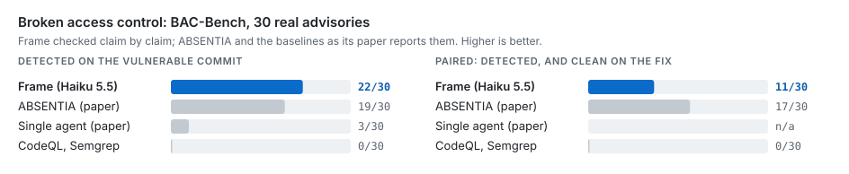

# BAC-Bench: Frame's authorization hunt

[BAC-Bench](https://github.com/avduarte333/Absentia) is 30 disclosed broken-access-control
advisories in 25 open-source web applications (18 Python, 9 TypeScript, 3 JavaScript; Django, DRF,
FastAPI, Flask, Express, Koa, Next.js/tRPC, Astro, Payload). Each case pins a vulnerable and a fixing
commit. This report is Frame's agentic authorization hunt (`frame scan --hunt-authz`) on all 30, with
Claude Haiku 5.5 as the model. How the harness runs and scores is in [README.md](README.md).

## Result

| System | Detected | Paired | Scored by |
|--------|:--------:|:------:|-----------|
| **Frame hunt (Haiku 5.5), claim checked** | **22/30** | **11/30** | each matched finding read against the advisory |
| Frame hunt (Haiku 5.5), deterministic matcher | 25/30 | 12/30 | `score.py` (regions) |
| ABSENTIA (paper) | 19/30 | 17/30 | LLM judge (paper, Section 5.2) |
| Unstructured agent, same model (paper) | 3/30 | | |
| CodeQL, Semgrep (paper) | 0/30 | 0/30 | |

*Detected* means a finding states the advisory's flaw on the vulnerable commit. *Paired* means
detected, and no such finding on the fixing commit.

What the numbers say:

- **Detection:** Frame finds more of the advisories than ABSENTIA, 22 against 19.
- **Pairing:** it trails, 11 against 17. On the fixing commit the agent often reports a
  *different* plausible flaw in the same function. For example, on aegra it reports an assistant
  lookup next to the fixed thread check. The matcher cannot tell two claims in one function
  apart, so it counts the pair as not fixed.

The ABSENTIA, CodeQL and Semgrep rows are the paper's numbers, quoted for orientation. They are not
re-run here, and the paper scores with an LLM judge where this report checks claims by hand (see
[Method](#method)).

## Per case

`run` is the run the result comes from (see [Method](#method)). *Matcher* is the deterministic
score. *Claim* is the manual check of the matched finding:

- **flaw:** the finding states the advisory's flaw.
- **other flaw:** the finding is in the right code but describes a different bug.
- **location only:** an engine finding at the advisory's sink, with no explanation of the
  missing check.

| Case | Stack | run | Matcher | Claim | Note |
|------|-------|:---:|---------|-------|------|
| actualbudget | TS / Express | h4 | paired | flaw | `verifyFileExists` checks existence, not owner |
| aegra | Py / FastAPI | h4 | detected | flaw | `_prepare_run` uses the caller's `thread_id` unscoped |
| askbot | Py / Django | h4 | miss | (mechanism) | names the decorator fallthrough to `login_required`, but the findings sit on the decorated views, outside the matcher's regions |
| flowise | TS / Express | h4 | paired | flaw | `Object.assign` lets the body override `id` / `workspaceId` |
| FUXA | JS / Express | h4 | detected | flaw | scheduler writes check guest only, no admin permission |
| git-proxy | TS / Express | h4 | detected | other flaw | reports `action.user` taken from the pack's committer; the advisory is commits outside the approved range |
| indico | Py / Flask | h5 | miss | | mapped and investigated, judged safe |
| khoj | Py / FastAPI | h4 | paired | flaw | Notion OAuth callback binds by a caller-supplied id |
| langflow-7grx | Py / FastAPI | h4 | paired | flaw | image download reachable without auth or flow ownership |
| langflow-8c4j | Py / FastAPI | h4 | detected | flaw | owner filter only inside the `AUTO_LOGIN` branch |
| langflow-rf6x | Py / FastAPI | h4 | paired | flaw | API key deleted by id without an owner check |
| mlflow | Py / Flask | h4 | paired | other flaw | reports the scorer-invoke route's always-true validator; the advisory is the artifact route |
| n8n | TS / Express | h5 | paired | flaw | execution stop loads by id without workflow access |
| open-webui | Py / FastAPI | h4 | detected | flaw | any shared chat linking a file grants every user access |
| outline | TS / Koa | h4 | paired | flaw | `shares.create` authorizes the collection, never the document |
| parse-server | JS / Express | h5 | miss | | ground-truth file never mapped |
| payload-puck | TS / Payload | h5 | detected | flaw | local API calls without `overrideAccess: false` |
| plane | Py / DRF | h5 | detected | flaw | asset `post()` loads the workspace by slug with no membership check; duplicate reads an unscoped source asset |
| pretix | Py / Django | h4 | detected | location only | engine IDOR candidates at the cached-file lookups |
| rallly | TS / Next.js tRPC | h4 | paired | flaw | comment delete by id with no author or admin check |
| saltcorn | JS / Express | h5 | miss | | mapped and investigated, judged safe |
| strapi | TS / Koa | h5 | miss | | ground-truth file never mapped |
| studiocms | TS / Astro | h5 | paired | flaw | notification update targets the payload `id`, not the session user |
| tandoor | Py / DRF | h4 | detected | flaw | `batch_update` is `detail=False`, so `has_object_permission` never runs |
| wagtail | Py / Django | h4 | detected | flaw | preview loads the object with no per-object permission |
| weblate-3pmh | Py / DRF | h4 | detected | flaw | notification subscriptions readable for any user |
| weblate-mpf5 | Py / DRF | h4 | paired | flaw | translation memory create reaches `save` with no permission check |
| weblate-wppc | Py / DRF | h4 | detected | flaw | add-on list queryset unfiltered, configuration exposed |
| wger-42cr | Py / DRF | h4 | detected | flaw | cache read before the ownership check, key has no user |
| wger-g8gc | Py / DRF | h4 | paired | flaw | nutritional values looked up by an unscoped pk |

Of the 25 cases the matcher credits, 22 state the advisory's flaw, 2 describe another flaw in the
same code, and 1 is an engine candidate at the right sink with no reasoning. askbot is the reverse
case: the agent found the mechanism, but the matcher does not credit it.

## Where the misses are

The hunt first maps the application's routes and handlers, then sends one agent per unit of code.
The funnel shows how far each case got:

| Stage | Cases |
|-------|:-----:|
| Ground-truth file in the map | 24 |
| Investigated by an agent | 27 |
| Agent reported on a ground-truth file | 24 |
| Agent judged a ground-truth file safe | 3 |

Of the five misses:

- **parse-server, strapi:** no unit owned the ground-truth file, even with scouts. The traces
  show the agents did look at it: four units each read parse-server's `SharedRest.js`
  (`enforceRoleSecurity`) and strapi's `document-service/repository.ts` while following their
  handlers, then judged their own handlers and moved on. No agent was asked for a verdict on the
  shared code itself. The hunt now gives such code a unit of its own after the first wave (code
  read by at least two units and owned by none). That change was made after these runs and has
  not been measured on them.
- **indico, saltcorn:** mapped and investigated, but the agent judged the code safe.
- **askbot:** the agent found the mechanism, but the matcher does not credit it (see above).

## Method

Two runs on the same harness, model and settings (`--hunt-concurrency 8`, verdict cache on, no
time limit per case):

- **h4: all 30 cases, unit mode.** The engine plans units of handlers, and an agent audits each
  unit. Framework base classes give subclasses their unwritten actions (DRF viewsets).
- **h5: the scout build, on h4's 8 misses whose ground-truth file was never mapped.** Before the
  units, scout agents explore the repository by area and list its routes, data services and
  authorization helpers. They teach the engine route conventions it does not see. The functions
  they find become units of their own.

The combined result takes h5 for those 8 cases and h4 for the other 22. h5 found 4 of the 8
(n8n, studiocms, payload-puck, plane) and mapped 2 more (indico, saltcorn), where the agent
then judged the code safe. Scouts were not run on the 22 cases h4 already
covered. A full run with scouts could change those cases, for better or worse.

**Scoring.** The deterministic matcher (`match.py`, `regions.py`) credits an access-control CWE
inside one of the advisory's code regions. The window-only rule gives 25 detected and 13 paired. The
matcher cannot tell two claims in one function apart. Each of the 25 matched cases was therefore
also read by hand against the advisory's `match_criteria`: the claim was taken from the run's
trajectory where the stored description was cut short. That check is ours, not the paper's judge,
which is not public. Reading khoj or langflow-7grx as matches is a judgement call; a stricter reader
could reject them.

Both tiers are scored separately:

| Tier | Detected | Paired |
|------|:--------:|:------:|
| Hunt agent (`llm_detect` / `llm_verified`) | 24 | 13 |
| Engine (`symbolic`) | 3 | 1 |

Each tier is scored on its own fixing-commit findings. The blended row at the top counts both, so an
engine finding on a fixing commit can undo an agent's pair.

**Cost.** The combined result took about 15.5 hours of scan time over the 60 checkouts, on an 8-core
machine. The large Django apps are dominated by the engine's pre-scan: pretix takes 159 minutes over
its two commits. No case hit a transport error.

The per-case scores are in [`results/haiku-5.5.json`](results/haiku-5.5.json).
