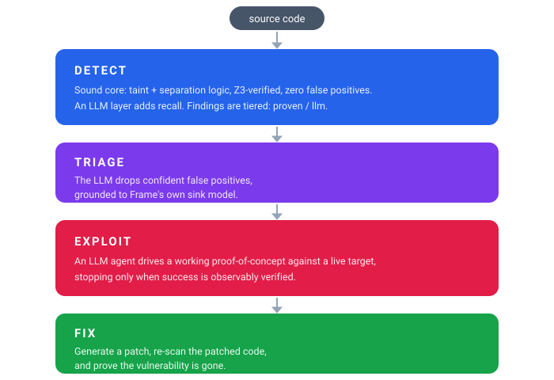

# The AI layer: detect, triage, hunt, exploit, fix

Structural analysis cannot reach everything: frameworks it does not know, flows that depend on context, and flaws that turn on intent, such as who should be allowed to read which record. The AI layer adds a model at those points, and the symbolic engine grounds it at every stage. It is optional: every command works without it.

<p align="center">
  
</p>

| Stage | Command | What the model does | What keeps it honest |
|---|---|---|---|
| Detect | `frame scan --ai` | explores the repository with file and search tools and traces flows across files; also covers languages with no symbolic frontend (PHP, Ruby, Go) | a finding grounded in a sink Frame recognises is `llm-verified`, otherwise `llm-detected`; never merged with the engine's findings |
| Triage | `frame scan --ai` | drops confident false positives | a finding is kept unless the model names the control that mitigates it |
| Hunt | `frame scan --hunt-authz` | audits authorization and business logic, unit by unit ([below](#hunting-authorization-flaws---hunt-authz)) | a finding needs the invariant and a concrete violating request; the engine's facts decide its tier |
| Exploit | `frame exploit` | builds and runs a proof of concept against a live target you are authorized to test | it stops only on observable success (`--success-check '<cmd>'` for an external oracle) |
| Fix | `frame fix` | writes a patch | the patch is kept only if a re-scan shows the bug gone and nothing new |

## Setting it up

Any OpenAI-compatible endpoint works: a local server, a hosted open model, or a frontier API. The endpoint and model come from the environment or from the `[llm]` table of `.frame.toml`; the variables win over the file.

```bash
export FRAME_LLM_BASE_URL=http://localhost:47317/v1     # any OpenAI-compatible endpoint
export FRAME_LLM_API_KEY=                                # empty for local servers
export FRAME_LLM_MODEL=mlx-community/Qwen3.6-35B-A3B-OptiQ-4bit

frame scan src/ --ai                                     # symbolic + LLM detection + triage
frame scan src/ --hunt-authz                             # the authorization hunt
frame scan ./repo --ai -f json | \
  frame exploit --target http://app:8080 --guidance - --goal 'read /etc/secret'
frame fix app.py --guidance findings.json --diff         # patch, re-scan, confirm
```

```toml
# .frame.toml
[llm]
base_url = "https://openrouter.ai/api/v1"
model = "anthropic/claude-haiku-5.5"
api_key_env = "OPENROUTER_API_KEY"   # the variable that holds the key; never the key itself
stream = true
```

Everything else about the model (timeouts, streaming, retries, agent budgets, waiting out an outage) is a key of `[llm]`, listed in [usage.md](usage.md#configuration); [`examples/configs/ai.toml`](../examples/configs/ai.toml) is a starting point. `--model` overrides the model for one run. A directory scan gives the agents' file tools the scanned directory as their root (`--root` names another).

With a hosted endpoint, code snippets leave the machine; a server on your own machine keeps them local ([below](#local-on-apple-silicon)).

On the [Endor Labs corpus](../benchmarks/endor_corpus/README.md), detection plus triage reaches 0.67 recall at 0.51 precision (Semgrep: 0.52 / 0.40); the model recovers about 65 vulnerabilities in Java, JS/TS and C# that both the engine and Semgrep miss.

## Hunting authorization flaws (`--hunt-authz`)

Broken access control turns on intent: who should be allowed to do what to which object. A dataflow engine cannot decide that alone, and a single agent left to roam a repository spends its budget where its curiosity takes it (3 of 30 BAC-Bench advisories in ABSENTIA's measurement). `frame scan DIR --hunt-authz` hunts for IDOR, missing authorization, privilege escalation, mass assignment and client-controlled server values with the engine directing the work and answering the agents' questions.

On [BAC-Bench](../benchmarks/bacbench/REPORT.md), 30 real advisories in 25 open-source apps, the hunt with Claude Haiku 5.5 finds 22 of 30, against 19 for ABSENTIA and 0 for CodeQL and Semgrep. It pairs fewer with the fix (11 against 17): on the fixing commit its agents often report a different flaw in the same function.

### How it works

1. **Scouts map the application.** The repository is split into areas (a monorepo's packages, a large app's directories), and one scout per area lists every route a remote caller reaches, every service function that reads or changes stored data, and every authorization helper. When the engine does not see routes a scout found, the scout writes a [framework pack](coverage.md#teach-it-your-own-framework) for the convention; the pack schema accepts or rejects it, and the engine rescans with it. Taught packs are saved with the trace (`scout/taught-N.toml`), ready to keep in `.frame/packs/`. The scouts' summaries become the authorization profile every later agent reads.
2. **The engine plans units.** Handlers are grouped into small units (a class's handlers, or a file's functions, so a check one sibling lacks stands out). The service functions and authorization helpers the handlers delegate to get units of their own, and so does anything the scouts found that the engine still does not cover. A handler a framework base class serves without the class writing it (a Django REST Framework `ModelViewSet`'s `list` or `update`) is a member too, described by its pack's `[[provided_action]]`. Units are ranked by engine facts only: an unverified authorization candidate, data access without a gate, siblings that disagree about protection.
3. **One agent per unit, with the engine as a tool.** Each unit gets a fresh agent (8 at a time by default). Besides reading and searching code it can ask the engine: `guards` lists the checks that hold on every feasible path to a data access, `check` proves or refutes one (a refutation comes with a path that avoids it), `siblings` puts the neighbouring handlers' checks side by side, `callees` and `callers` follow the call graph into the service layer, `trace` shows which request values reach which data access, and `engine_scan` runs the solver-verified engine on another file.
4. **A verdict on every member.** The agent is sent back if it stops with a member undecided. There are three verdicts:
   - `report_finding`: requires the invariant the code should guarantee and a concrete request that violates it (who sends what, to which endpoint, with what they already have). A claim that cannot be turned into such a request is not recorded.
   - `mark_safe`: requires the check that enforces the invariant, or why the endpoint is public by design.
   - `mark_unresolved`: for an answer that depends on something the repository does not hold (a configuration value, the roles a deployment assigns, a library's behaviour). It must state the suspected flaw, where the agent looked, and the fact that would decide it. It is not a finding; it is listed for a person to settle, rather than hidden behind a confident "safe".
5. **Coverage before finishing.** Agents follow a handler into the code it relies on. A file that two or more units read to reach their verdicts, and that no unit owns, is a layer those verdicts depend on that nobody was asked to judge, so it gets a unit of its own after the first wave. In BAC-Bench, two of the misses were exactly this: four units each read parse-server's `enforceRoleSecurity` and strapi's document-service repository, and none audited them.

A finding the engine's facts corroborate (the handler reaches data and is not protected) is `llm-verified`; one that rests on intent alone, or on code only a scout found, is `llm-detected`. Only a solver-verified engine finding suppresses an agent's finding at the same place. Where Frame has no frontend for the language, one agent hunts the repository with search and file tools instead, and every finding is `llm-detected`.

### Running it

```bash
frame scan . --hunt-authz -f json -o findings.json
```

The output has a `hunt` section beside the findings (JSON key `hunt`): how the hunt ended (`stop`: `finished`, `partial`, `transport_error`, `exception`), the units audited and deferred, the coverage units, and every `unresolved` member with its file, line, suspicion and the fact that would decide it. A hunt that did not finish is warned about on stderr, so an endpoint that went down is never read as a clean result.

The budgets are the `[hunt]` table ([usage.md](usage.md#configuration), [`examples/configs/hunt.toml`](../examples/configs/hunt.toml)):

| Key | Default | |
|---|---|---|
| `concurrency` | 8 | unit agents at once |
| `unit_steps` | 24 | tool turns per unit |
| `max_units` | all | units audited; the rest are listed as deferred, never dropped silently |
| `scout_steps`, `max_scouts` | 30, 16 | turns per scout and scouts per repository; `scout_steps = 0` turns scouting off |
| `coverage_readers` | 2 | how many units must have read unowned code for it to get a unit; 0 turns the coverage wave off |
| `trajectory_dir` | | keep every agent's trace (HF Session-Trace JSONL); an interrupted run resumes from it |

For long unattended runs, set `[llm] outage_wait` so a network drop is waited out instead of ending the hunt. The Python API takes the same budgets as `FrameScanner(hunt_authz=True, hunt_options={...})`, plus `verdict_cache`: a JSON file that reuses a unit's verdicts on another checkout when every file its agent read is unchanged.

A hunt is as expensive as the application is large: one agent per unit, every unit audited by default. On BAC-Bench the 60 checkouts took about 15.5 hours of scan time on an 8-core machine, much of it the engine's pre-scan of the largest Django apps. `max_units` bounds it.

## Proof-carrying findings (`--confirm-proofs`)

When the symbolic engine proves a finding reachable it also computes the concrete inputs that reach it. `frame scan --confirm-proofs` turns those inputs into a test, runs it, and raises the finding to the `exploit-confirmed` evidence level only when the fault is actually observed. A finding with a reproduced test is a true positive by construction. This step runs compiled code, so it is opt-in; it uses no model and no network, and never contacts a live target.

Today it covers the C integer-overflow and out-of-bounds findings (CWE-190/191/194/195/197 and CWE-125/787/124/127), whose trigger is an attacker integer leaving a range. Each such finding carries a `proof` in the JSON: the solver's `witness` (the concrete values), the `inputs` restricted to the function's parameters, whether it is directly `constructible` (every triggering value is a scalar parameter, so the function can be called with them), and the triggering condition.

```bash
frame scan src/ -l c --confirm-proofs --proof-tests-dir tests/frame-proofs
```

For each directly constructible finding, Frame compiles the file with a `main` that calls the function with the witness inputs, under AddressSanitizer and UndefinedBehaviorSanitizer, and runs it. An observed fault (a sanitizer report or a non-zero exit) confirms the finding and records the run on its `proof`; anything else (a function that does not compile on its own, a guard that makes it safe, no compiler) leaves the finding exactly as it was. With `--proof-tests-dir`, each confirmed finding's reproduction test is written there as a self-contained C file: a regression guard that must stop faulting once the bug is fixed.

A finding whose triggering value is not a function parameter (for example an integer read from stdin) still records its witness, but is not directly constructible: calling the function alone will not reach it. `--reproduce-proofs` (which implies `--confirm-proofs`) handles those with a small seeded agent. The agent is given the source and the solver's witness and asked to write a complete reproduction program that drives the real input path so the fault fires; the harness compiles and runs it under the same sanitizers, and the loop stops only on an observed fault, never the model's claim. A reproduced finding is raised to `exploit-confirmed` and, with `--proof-tests-dir`, its program is written there. This uses the `[llm]` endpoint and runs a model, so it is opt-in; it still runs only against your own code in a local sandbox, with no live target.

### Dependency reachability as a runnable test (`frame exploit --deps`)

When `frame scan --sca` finds attacker data reaching a vulnerable library function in your own code (`reachability: tainted`), `frame exploit --deps` turns that into a test you can run. Give it the findings JSON and the project:

```bash
frame scan ./app --sca -f json -o findings.json
frame exploit --deps --guidance findings.json --root ./app --out-dir tests/frame-proofs
```

For each reachable finding a seeded agent explores the project, finds the entry point that leads to the vulnerable call, and writes a driver that passes a marker through it. A harness installs a spy on the vulnerable function and confirms the marker arrives there through the project's own code: calling the library function directly does not count (the flagged call site must be on the runtime stack), so the agent cannot fake the result. Each confirmed finding is written as a self-contained pytest that imports your entry point, spies on the vulnerable function, and asserts attacker data reaches it. The same command reproduces code injection flows (SQL injection, command injection and the other taint findings in the JSON): the sink -- a module function like `os.system` or a class method like a DB cursor's `execute` -- is spied the same way, so the test proves attacker data reaches the injection point through your code. Reproduction runs for Python and JavaScript/TypeScript projects (the JS sink, e.g. `child_process.exec`, is spied in Node), and for Java projects via a generated JUnit + Mockito test that construction-mocks a non-bootstrap library sink (a vulnerable dependency function reached through `new Lib().call(...)`; it needs a JDK and Maven). JDK bootstrap sinks such as `Runtime`/`ProcessBuilder` are not portably mockable this way and are left for the agent-based runner. Worked reproductions across languages are in [`benchmarks/exemplars/reproductions/`](../benchmarks/exemplars/reproductions/README.md). Drop it into your test suite: it passes while the reachable flow exists and fails once a fix removes it. This runs a model (the `[llm]` endpoint) against your own code in a local sandbox; there is no live target.

## Choosing a model

### Hosted

Open frontier models such as GLM are strong at security work: reading unfamiliar code, tracing flows and writing working exploits. The XBOW / ZeroPath results ran on GLM-5.2, CVE-Bench's exploits too (DeepSeek detected and fixed there), and BAC-Bench on Claude Haiku 5.5. With [mlx-optiq cloud](https://cloud.mlx-optiq.com), create an API key and point Frame at it:

```bash
export FRAME_LLM_BASE_URL=https://cloud.mlx-optiq.com/api/v1
export FRAME_LLM_API_KEY=sk-optiq-cloud-...              # from the dashboard's API keys page
export FRAME_LLM_MODEL=glm-5.3-flash                     # or glm-5.3 for the hardest repos

frame scan src/ --ai
```

`curl https://cloud.mlx-optiq.com/api/v1/models` lists the available models (also `deepseek-v4.1-flash` and `minimax-m3.1-flash`), each with a context window of about 1M tokens, enough for a whole service.

### Local, on Apple Silicon

To keep code on the machine, serve a quantized model with mlx-optiq:

```bash
pip install mlx-optiq
optiq kv-cache mlx-community/Qwen3.6-35B-A3B-OptiQ-4bit --target-bits 5.0 -o ./kv
optiq serve --model mlx-community/Qwen3.6-35B-A3B-OptiQ-4bit \
  --kv-config ./kv/kv_config.json --port 47317 --mtp    # --mtp: ~1.4x faster decode
```

Then use the local endpoint from [Setting it up](#setting-it-up) (`http://localhost:47317/v1`, empty key).

## Fixing vulnerable dependencies in code

When an upgrade is not possible yet (`frame deps --apply` does upgrades), `frame fix --deps` changes how the code uses the vulnerable function and leaves the version alone:

```bash
frame kb pull --advisories
frame fix src/ --deps --diff          # each call site attacker data reaches (frame scan --sca)
frame fix src/ --deps --in-place      # write only the verified patches
```

Every patch is verified by re-running the whole analysis on a patched copy of the project: it is kept only if attacker data no longer reaches the vulnerable function (or the call is gone) and the file has no new finding. A character-class check in front of the call is not enough (a long digit string is still a ReDoS input); a constant allowlist or the library's safe equivalent (`yaml.safe_load`) is. `--include-called` also takes call sites without a flow, verified only when the call is gone. More in [dependencies.md](dependencies.md#fixing-in-code-when-you-cannot-upgrade).
