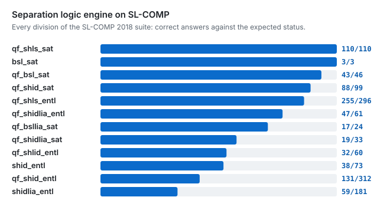

# The separation logic engine

Underneath the scanner is a separation logic prover built on Z3, usable on its own from the CLI or Python. Heaps are encoded as Z3 arrays with explicit allocation domains (the heap-as-array approach of Piskac, Wies and Zufferey), and inductive predicates are reasoned about with lemmas, goal-directed folding and adaptive unfolding before anything reaches the SMT solver.

In the scanner, a per-language frontend lowers source into SIL, a separation intermediate language. Taint tracking follows untrusted data from sources to sinks through calls, returns and branches; symbolic execution explores paths with per-edge path conditions, and Z3 discharges the reachability proof, so a bug is reported only when its path is feasible. C and C++ memory safety is decided by tracking ownership and heap state in separation logic.

<p align="center"></p>

## Capabilities

| Capability | What you get |
|---|---|
| **Entailment** `P \|- Q` | Valid or invalid, with a Z3 countermodel for invalid ones (`--model`) |
| **Satisfiability and equivalence** | `is_satisfiable(P)`, `check_equiv(P, Q)`; contradictions such as `x \|-> 1 * x \|-> 2` are detected |
| **Frame inference and bi-abduction** | `find_frame(P, Q)` returns the leftover heap R with `P \|- Q * R`; `abduce_frame` returns the missing heap |
| **Inductive predicates** | list segments `ls`, null-terminated `list`, doubly linked `dll`, binary `tree`, sorted `sls`, nested `nll`, skip lists `skl1`-`skl3`, `lsso`, reversed `RList` |
| **Custom predicates** | Define your own (in Python or from SMT-LIB definitions); each is validated for strict positivity, bound variables and arity before use |
| **Proof techniques** | Lemma library (list, DLL, compositional and wand lemmas), goal-directed folding of points-to chains into predicates, cyclic unfolding, heap-graph pattern analysis, syntactic fast paths |
| **Theories** | Linear integer arithmetic, strings (concatenation, length, substring, `contains`, regex `matches`), arrays and bitvectors, all combined with the heap |
| **Security vocabulary** | `Source`, `Sink`, `Taint`, `Sanitized` and error states (`NullDeref`, `UseAfterFree`, `BufferOverflow`) as first-class formulas |
| **Magic wand** | `P -* Q` in the AST and SMT encoding, with wand lemmas |
| **Robust by design** | Bounded, adaptive unfolding; deep recursion and solver timeouts return `unknown` instead of crashing |

## From the command line

```console
$ frame solve "x |-> y * y |-> nil |- ls(x, nil)"
✓ VALID
$ frame solve 'x = "ab" ++ "c" |- x = "abc"'
✓ VALID
$ frame solve "x |-> 5 |- x |-> 6" --model
✗ INVALID
  Countermodel: [x = 2, hval = [else -> 5], ...]
$ frame check entailments.txt --format json          # batch mode, one entailment per line
$ frame parse "x |-> 5 * ls(y, nil)" --format tree   # formula structure (tree, json, sexp)
$ frame repl                                          # interactive prover
```

`frame solve` also takes `--unfold-depth`, `--timeout` and `--format json`; `frame check` takes `--stop-on-failure` and `--format json|csv`.

## From Python

```python
from frame import EntailmentChecker, parse

checker = EntailmentChecker()
checker.check_entailment("ls(x, y) * ls(y, nil) |- ls(x, nil)").valid        # True
checker.find_frame(parse("x |-> 5 * y |-> 3"), parse("x |-> 5"))            # y |-> 3
checker.is_satisfiable(parse("x |-> 1 * x |-> 2"))                          # False
```

## Syntax

| Syntax | Meaning |
|--------|---------|
| `emp`, `x \|-> v` | empty heap; x points to v (`x \|-> (a, b)` for records) |
| `P * Q` | P and Q hold in disjoint parts of the heap |
| `P & Q`, `P \| Q`, `!P` | conjunction, disjunction, negation |
| `x = y`, `x != y`, `x < y + 1` | equality and arithmetic |
| `exists x. P`, `forall x. P` | quantifiers |
| `P \|- Q` | P entails Q |

## Benchmarks

Every SL-COMP division runs from one harness, which reads the competition's SMT-LIB 2 files directly:

```bash
git clone --depth 1 https://github.com/sl-comp/SL-COMP18
python -m benchmarks run --division qf_shls_entl --cache-dir SL-COMP18/bench
```

[benchmarks/README.md](../benchmarks/README.md) has every division, corpus and method.
